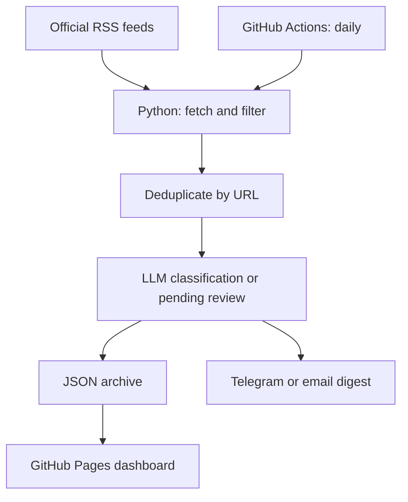

# ◈ AI Regulatory Radar

**Automated EU AI & digital regulation monitoring · Python · LLM classification · GitHub Actions · GitHub Pages**

An open-source portfolio project that collects updates from official European institutional RSS feeds, classifies them with an LLM, stores a transparent JSON archive, and generates an Italian-language regulatory dashboard. Optional Telegram and email digests keep subscribers informed.

> **Disclaimer:** This is an educational information tool, **not legal advice**. AI-generated summaries can be inaccurate. Every item links to the original institutional source. Deadlines and legal effects must be checked against the latest consolidated legislation.

## ✨ Features

- **Daily automation** via GitHub Actions (also manually runnable).
- **Primary-source ingestion:** EDPB and EUR-Lex RSS sources preconfigured; placeholders for EU Commission/AI Office and Italian Garante Privacy pending feed verification.
- **Keyword-based triage** of AI, privacy and digital-regulation updates.
- **LLM classification** in Italian: related act, publication type, summary, what's changed, who is affected, editorial urgency, uncertainty and human-review flag.
- **Evidence by design:** original link and institution retained; no fabricated citations or inferred legal deadlines.
- **Deduplicated, auditable archive:** `data/items.json` with stable link-derived IDs.
- **Static dashboard:** responsive GitHub Pages site featuring search, filters and a manually curated legal timeline.
- **Optional alerts:** Telegram or SMTP email on newly discovered items.
- **Graceful fallback:** without an API key, items are preserved as *pending review* instead of generating misleading summaries.

### Architecture



## 🗂️ Repository structure

```text
ai-regulatory-radar/
├── .github/workflows/daily.yml  # Daily scheduled workflow
├── config/sources.json          # Official feed registry
├── config/milestones.json       # Manually maintained legislative timeline
├── data/items.json              # Archived articles
├── docs/index.html              # GitHub Pages generated output
├── prompts/classification_it.md # Auditable Italian classification prompt
├── src/pipeline.py              # Monitoring, AI, alerts
├── src/build_dashboard.py       # Static website generator
├── templates/dashboard.html     # Frontend template
├── tests/test_pipeline.py       # Automated checks
├── .env.example                 # Secret names, never credentials
└── requirements.txt
```

## 🚀 Local quick start (beginner friendly)

1. Install **Python 3.12** and **Git**.
2. Download/clone the repository. Open a terminal in its directory.
3. Create a virtual environment and install packages:

   ```bash
   python -m venv .venv
   # Windows PowerShell:
   .venv\Scripts\Activate.ps1
   # macOS/Linux:
   # source .venv/bin/activate
   pip install -r requirements.txt
   ```

4. Preview feed results without writing or sending alerts:

   ```bash
   python -m src.pipeline --dry-run
   ```

5. Populate the archive without sending notifications:

   ```bash
   python -m src.pipeline --skip-notify
   python -m src.build_dashboard
   ```

6. Open `docs/index.html` in a browser. The included archive contains **18 actual feed entries collected on 17 November 2026**, marked pending classification; it contains no fabricated demonstration articles. Future runs add only new items.
7. Run tests: `python -m pytest -q`.

### Add AI summarization

The program currently supports **OpenAI**. Claude can be added as an alternative backend later; it is not implemented in this version.

Set `OPENAI_API_KEY` as an environment variable locally (do **not** hardcode it). You can also set `OPENAI_MODEL` to an available model compatible with JSON response mode. On Windows PowerShell:

```powershell
$env:OPENAI_API_KEY="your-key-here"
python -m src.pipeline --skip-notify
```

**Important:** API usage is normally metered and is not included in the free GitHub Actions allowance. The Actions runner can be free subject to GitHub's plan, usage limits, public-repository rules and policy changes; the end-to-end solution is **not guaranteed free** if you activate paid LLM calls. Existing items are not reclassified automatically after a key is added: run `python -m src.pipeline --skip-notify --reclassify-pending` once to process pending archive entries (this may incur API charges).

## 🌐 Publish the dashboard with GitHub Pages

1. Create a GitHub repository named `ai-regulatory-radar` and upload these files (including `.github/`).
2. Under **Settings → Pages**, choose **Deploy from a branch**, branch `main`, folder `/docs` (if your default branch is named differently, choose that branch).
3. Under **Actions**, manually run **Daily regulatory radar** once.
4. Your site will normally appear at `https://YOUR-USERNAME.github.io/ai-regulatory-radar/` after Pages finishes deploying.
5. The workflow needs permission to push commits: check **Settings → Actions → General → Workflow permissions → Read and write permissions** if the push is denied. Repository or organizational policies may override this setting.

Scheduled workflows can be delayed or disabled for inactive repositories, and external feeds may occasionally be unavailable. This is **daily batch monitoring**, not real-time legal surveillance.

### Enable Telegram alerts (optional)

1. Use Telegram's BotFather to create a bot and obtain its token.
2. Send your bot a message; obtain the target `chat_id` using the Telegram Bot API.
3. In your GitHub repository, open **Settings → Secrets and variables → Actions** and add `TELEGRAM_BOT_TOKEN` and `TELEGRAM_CHAT_ID`.
4. Manually trigger the workflow after new items are available. Only **new** items trigger a digest.

### Enable email alerts (optional)

Set these repository secrets: `SMTP_HOST`, `SMTP_PORT`, `SMTP_USER`, `SMTP_PASSWORD`, `EMAIL_FROM`, `EMAIL_TO`. Choose a provider that supports authenticated SMTP and app-specific credentials when required. Do not commit `.env` or API keys.

## 🏛️ Institutional source policy

| Institution | Coverage | Status |
| --- | --- | --- |
| [European Data Protection Board](https://www.edpb.europa.eu/news_it) | GDPR, privacy, guidance and regulatory news | RSS configured |
| [EUR-Lex](https://eur-lex.europa.eu/content/help/search/predefined-rss.html?locale=it) | Broad EU legislative feed; keyword filtering | RSS configured |
| [EUR-Lex custom RSS alerts](https://eur-lex.europa.eu/content/help/my-eurlex/my-rss-feeds.html?locale=it) | Targeted AI Act / GDPR / Data Act searches | Setup required |
| [European AI Office](https://digital-strategy.ec.europa.eu/en/policies/ai-office) | AI Act and EU AI policy news | Feed verification required |
| [Italian Garante Privacy](https://www.garanteprivacy.it/gpdp-rss) | Italian data protection decisions | Feed verification required |

To add a feed, edit `config/sources.json`: enter a **verified institutional RSS/Atom URL** and set `enabled` to `true`. Never enter a generic HTML news page as if it were an RSS endpoint. Check each site's usage conditions and avoid aggressive crawling. The broad EUR-Lex RSS feed may contain many unrelated legal acts; keyword screening can omit relevant items or include false positives. This is a known coverage limitation.

## ⚖️ Regulatory timeline

`config/milestones.json` contains selected milestone dates from official regulations: [AI Act (EU) 2024/1689](https://eur-lex.europa.eu/eli/reg/2024/1689/oj), [GDPR (EU) 2016/679](https://eur-lex.europa.eu/eli/reg/2016/679/oj) and [Data Act (EU) 2023/2854](https://eur-lex.europa.eu/eli/reg/2023/2854/oj). The timeline is **manually curated**, not reconstructed automatically from live law. Particularly for future AI Act dates, verify amendments, postponements and transitional measures before treating them as legally operative.

## 🔎 Methodology and limitations

- **Provenance:** only configured institutional domains/feeds; preserve title, publication date where provided, source name and primary URL.
- **Scope:** metadata/summary snippets only; the classifier does **not** fetch or analyze the entire legal text. A full-text, human-validated extension is a future improvement.
- **Uncertainty:** prompts explicitly prohibit inventing law, dates and sanctions and distinguish proposals, guidance, press releases and binding acts.
- **Urgency:** purely editorial. **Not** a legal risk assessment or compliance instruction.
- **Quality:** reviews are flagged; model output is not certified by a lawyer; keyword filter may produce misses or false positives.
- **Reliability:** per-feed failures are logged and do not block the rest. Failed notifications are logged; successful archiving doesn't imply delivery. No delivery retry queue yet.
- **Security:** tokens in GitHub Secrets; generated dashboard embeds only archived public text, not credentials. Treat source text as untrusted to avoid prompt injection.
- **Privacy:** configure recipient consent before enabling digests; do not store private subscriber data in the public repository.

## 🧭 Roadmap

- [ ] Add and verify EU Commission/AI Office and Italian Garante feeds.
- [ ] Add Claude as a second classification backend.
- [ ] Add schema validation, monitored-source health reports and alert retries.
- [ ] Add full-text retrieval with citation extraction and human-review workflow.
- [ ] Add export CSV, weekly digests and time-based deadline filters.

## 💼 CV description

**AI Regulatory Radar — Personal Project | Python, OpenAI API, GitHub Actions, GitHub Pages**  
Developed an automated monitoring pipeline for official EU regulatory updates, featuring LLM-assisted Italian summaries, structured impact classification, source-linked archives, a filterable public dashboard, and optional Telegram/email notifications. Designed safeguards for traceability, human review, and legal-information reliability.

*Use this description only after actually running and publishing the project; adapt features to those you have enabled.*

---

**Educational portfolio project · Not legal advice.**
