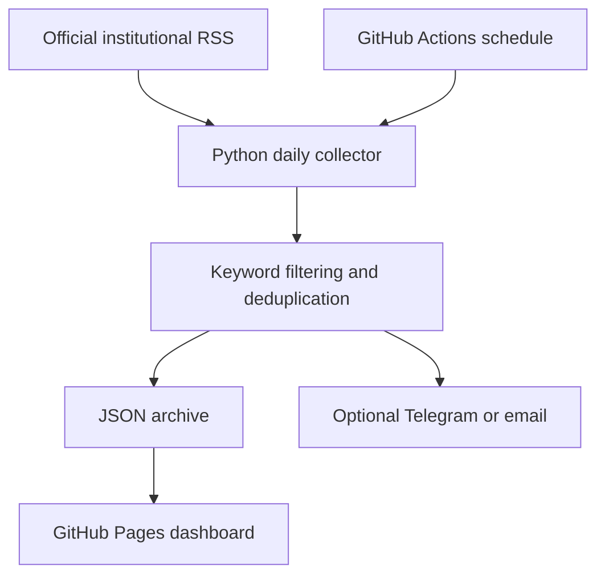

[README.md](https://github.com/user-attachments/files/34998331/README.md)
# ◈ AI & Digital Law

**Free, automated monitoring of EU AI and digital regulation**  
Python · RSS/Atom · GitHub Actions · GitHub Pages · Data Processing

AI & Digital Law (repository: `ai---regulatory---radar`) is a personal **RegTech portfolio project** that collects official institutional publications, stores an auditable archive, and automatically generates a searchable Italian dashboard. It uses **no AI model, API key, or paid summarization service**.

> **Not legal advice.** The software does not interpret legal obligations or assign legal urgency. Always consult original documents and their latest consolidated versions.

## Features

- Daily RSS/Atom collection via GitHub Actions (also manual trigger).
- Official institutional source registry in `config/sources.json`.
- Keyword filtering to screen relevance to AI, privacy and EU digital rules.
- Seven interactive regulatory areas, selectable directly in the dashboard: **Intelligenza artificiale** (AI Act, AI systems, generative models), **Privacy** (GDPR), **Governance dei dati** (Data Act, Data Governance Act), **Piattaforme digitali** (DSA), **Mercati digitali** (DMA), **Cybersecurity** (NIS2, Cyber Resilience Act), and **Novità legislative** (EU digital regulatory proposals). Each shows the actual number of matching archived publications.
- Broader digital coverage includes GDPR, Data Act, DSA, DMA, NIS2, cybersecurity, Data Governance Act, Cyber Resilience Act and selected EU digital legislative proposals; coverage remains dependent on enabled institutional RSS feeds.
- Simple **keyword-based topic tags**, e.g. AI Act, GDPR or Data Act. Tags are indicative and can be missing or incorrect; they are **not legal analysis**.
- Stable URL-derived IDs for deduplication and JSON archival in `data/items.json`.
- Responsive dashboard in `docs/index.html` with sidebar navigation, source/topic filters, an interactive monthly chart, expandable feed excerpts and a curated regulatory timeline.
- An institutional-source directory showing all configured sources, distinguishing active RSS feeds from sources awaiting integration, with the latest feed-check result and timestamps.
- Optional Telegram or SMTP email notifications for newly found entries.
- Original official link, title, feed excerpt, date (if provided) and institution retained.



## Institutional sources

| Source | Current integration |
| --- | --- |
| [EDPB news](https://www.edpb.europa.eu/news_it) | RSS enabled |
| [EUR-Lex legislative feeds](https://eur-lex.europa.eu/content/help/search/predefined-rss.html?locale=it) | Broad RSS enabled; filtered by keywords |
| [EUR-Lex personalised RSS](https://eur-lex.europa.eu/content/help/my-eurlex/my-rss-feeds.html?locale=it) | Ready for an official custom alert |
| [European Commission news](https://commission.europa.eu/news_en) | Official general RSS enabled; filtered by keywords |
| [Council of the EU — press releases](https://www.consilium.europa.eu/en/about-site/rss/) | Official RSS feed configured; reachability checked on next workflow run |
| [Italian Garante Privacy](https://www.garanteprivacy.it/gpdp-rss) | Official news RSS enabled |

The enabled feeds are **not comprehensive**. Some relevant publications may be missed, and keyword filtering can include false positives. Enable other feeds in `config/sources.json` only after checking their official RSS URLs.

## Run locally

Install Python 3.12 and run these commands in the project directory:

```bash
python -m venv .venv
```

Activate it (Windows PowerShell: `.venv\Scripts\Activate.ps1`; macOS/Linux: `source .venv/bin/activate`), then:

```bash
pip install -r requirements.txt
python -m pytest -q
python -m src.pipeline --dry-run
python -m src.pipeline --skip-notify
python -m src.build_dashboard
```

Open `docs/index.html` in your browser. The archive contains actual feed entries, not invented examples.

## GitHub Actions and GitHub Pages

`.github/workflows/daily.yml` runs **once per hour, at minute 17 UTC** (for example 08:17, 09:17 and 10:17 UTC); it can also be started via **Actions → Hourly regulatory radar → Run workflow**. GitHub may delay or occasionally skip scheduled executions, and scheduled workflows in inactive public repositories can be disabled. Every run checks the feeds; the dashboard changes only when new data or status information is recorded.

In **Settings → Pages**, select **Deploy from a branch**, `main`, `/docs`. The workflow needs `contents: write` to commit its archive and dashboard; repository or organization policy may restrict that. GitHub Actions and Pages can be used at no cost within applicable plan and usage limits.

### Optional notifications

For Telegram, set GitHub Actions repository secrets `TELEGRAM_BOT_TOKEN` and `TELEGRAM_CHAT_ID`. For email, set `SMTP_HOST`, `SMTP_PORT`, `SMTP_USER`, `SMTP_PASSWORD`, `EMAIL_FROM`, `EMAIL_TO`. Leave these empty for no notifications. Never commit private credentials or subscriber details.

## Project structure

```text
.github/workflows/daily.yml    Daily automation
config/sources.json            Official RSS source registry
config/milestones.json         Curated reference timeline
data/items.json                Archived publications
data/source_status.json        Latest feed checks and outcomes
docs/index.html                Generated dashboard
src/pipeline.py                Collector, filtering and alerts
src/build_dashboard.py         Static website generator
templates/dashboard.html       HTML/CSS/JavaScript dashboard
tests/test_pipeline.py         Automated tests
requirements.txt              Python dependencies
```

## Methodology and limitations

- Titles and excerpts come from RSS; **no AI summarization** or legal interpretation is performed.
- Topic tags are simple regular-expression matches, **not** legally authoritative categorization.
- The timeline is manually curated from [AI Act](https://eur-lex.europa.eu/eli/reg/2024/1689/oj), [GDPR](https://eur-lex.europa.eu/eli/reg/2016/679/oj) and [Data Act](https://eur-lex.europa.eu/eli/reg/2023/2854/oj). Check subsequent amendments, transitional rules and consolidated versions before relying on dates.
- Monitoring is **daily batch**, not real-time, and coverage is incomplete.
- Errors in notification delivery are logged; automatic retries are not yet implemented.
- This is an independent educational project, **not legal advice** and not affiliated with EU institutions.

## Roadmap

- [x] Verify and enable Commission news and Garante official feeds.
- [ ] Verify a dedicated AI Office feed or other stable official access method.
- [ ] Add source-health indicators and error alerts.
- [ ] Add CSV exports and weekly digests.
- [ ] Curate consultation deadlines separately from legislative milestones.
- [ ] Add link validation and human-reviewed taxonomy.

## CV-ready description

**EU AI Regulatory Monitor — Personal Project**  
*Python · GitHub Actions · RSS/Atom · GitHub Pages · Data Processing*

Developed an automated monitoring platform for official EU regulatory publications, featuring a daily Python ingestion pipeline, deduplicated JSON archive, keyword-based topic filters, responsive web dashboard and optional Telegram/email alerts. Designed for transparent provenance and legal-information reliability.
